<div align="center">

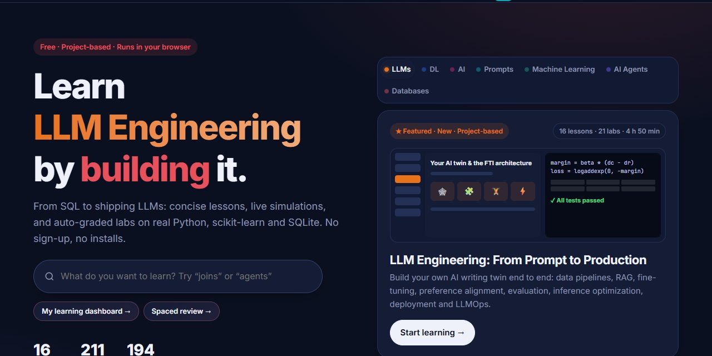

# learn/ai

### Learn databases, machine learning, LLMs and AI agents by building them, free, in your browser

**Created by [Rajesh Kumar](https://github.com/raja21068)**

**16 courses · 211 lessons · 194 hands-on labs · 421 practice questions · 27 graded coding labs · 70 illustrated textbook chapters**


[**Get started**](#-get-started) ·
[Courses](#-the-courses) ·
[Practice hub](#-practice-hub) ·
[Visualization lab](#-visualization-lab) ·
[Videos](#-videos) ·
[Textbooks](#-textbook-companion) ·
[Deploy](#-put-it-online-github-pages) ·
[Tests](#-tests) ·
[Credits](#-credits-and-licences)

</div>

---

## 🎯 What is this?

A complete learning site that is **just static files**. No server, no database, no account and no install: open it and you can run SQL against a real SQLite database, write Python that is graded by hidden tests, train a neural network, and read illustrated textbook chapters. Your progress is saved in your own browser and nothing is uploaded.

| | |
|---|---|
| 🧪 **Learn by doing** | Every lesson has a lab. SQL runs on SQLite (sql.js) and Python runs in the browser (Pyodide), so there is nothing to set up. |
| 🔮 **Predict, then run** | Interactive simulations ask you to predict the outcome before they run, which is how understanding sticks. |
| 📝 **Practice quizzes and coding labs** | 421 pre- and post-lesson questions and 27 algorithm, AI and machine-learning labs checked against brute-force tests. |
| 📈 **See the idea** | Interactive charts, editable diagrams and the TensorFlow Playground, also built into every textbook chapter. |
| 📚 **Textbook companions** | 70 guided chapters across seven textbooks, with original explanations, figures and practice. No book text is reproduced. |
| 🔁 **Remember it** | A learning dashboard, spaced review and evidence-of-understanding pages. |

<div align="center">
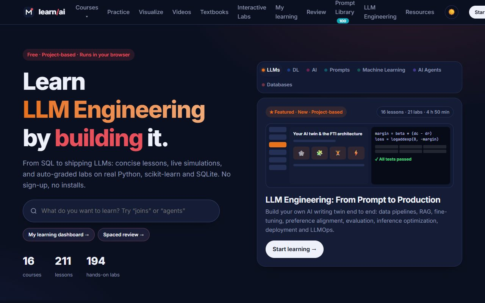
</div>

## 🚀 Get started

### Option 1: just open it
Put the site on GitHub Pages ([steps below](#-put-it-online-github-pages)) and share the link.

### Option 2: run it on your computer
You only need a way to serve static files. Python is enough:

```bash
git clone https://github.com/YOUR-USERNAME/YOUR-REPO.git
cd YOUR-REPO
python -m http.server 8000
```

Then open **http://localhost:8000**. On Windows you can instead **double-click `start-site.bat`** (Mac and Linux: `sh start-site.sh`).

> **Do not just double-click `index.html`.** A page opened as a file has no web address, so YouTube refuses to play embedded videos (*"Video player configuration error, Error 153"*) and a few readers cannot load their files. The site detects this, shows a banner, and offers "Watch on YouTube" links, but for the full experience use the start script or GitHub Pages.

### First time in the site?
1. Open **Courses** and pick one, for example *Machine Learning* or *Database Systems*.
2. Work through a lesson, then open its **lab** on the right.
3. Try the **Practice** hub for quizzes and coding labs, and **Visualize** for charts and the playground.

## 📘 The courses

| Course | Level | Lessons | How you practise |
|---|---|---:|---|
| Database Systems | Beginner to intermediate | 20 | SQL labs on real SQLite, an Index Lab that shows real query plans |
| Prompt Engineering | Beginner to intermediate | 24 | Python labs, a Prompt Lab with 3,888 prompt configurations |
| AI Agents | Intermediate | 21 | Python labs, an Agent Arena simulation |
| Artificial Intelligence | Intermediate | 20 | Python labs on search, reasoning, uncertainty and learning |
| Machine Learning | Beginner to intermediate | 18 | Python labs and an ML Lab (overfitting and data leakage) |
| Deep Learning | Intermediate | 18 | Python labs and 18 interactive widgets |
| LLM Engineering | Intermediate | 16 | Python labs and an LLM Service Lab (cost, quality, latency) |
| Algorithm Design | Intermediate to advanced | 21 | Proof labs, interactive algorithms, downloadable Python labs |
| Statistical Learning (ISLR with R) | Undergraduate to graduate | 10 | Interactive figures, downloadable R scripts |
| Operating Systems | Undergraduate | 15 | Guided study with interactive figures |
| Computer Networking | Undergraduate | 8 | Guided study with interactive figures |
| Starter courses: Python Essentials, Machine Learning, Blockchain Basics, Large Language Models, Agentic AI | Absolute beginner | 4 each | Short Python labs, notebooks and slides |

Five courses (AI Agents, Machine Learning, LLM Engineering, Prompt Engineering and Databases) also have a **coach** that gives personalised explanations from your mistakes, and an **evidence** page that records what you can actually show you understand.

<div align="center">
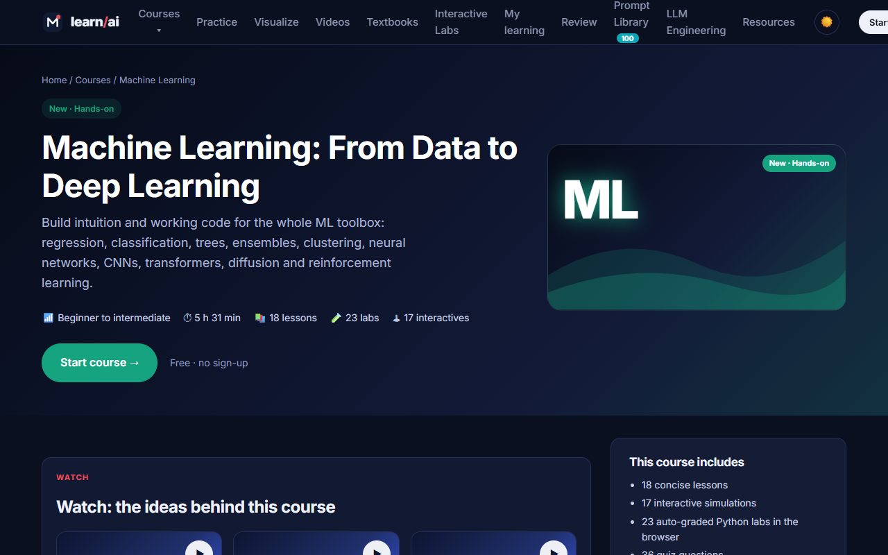
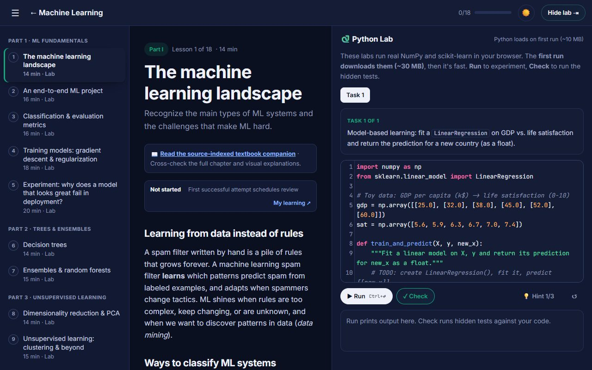
</div>

## 📝 Practice hub

`#/practice`: check what you know and write real code.

- **Practice quizzes:** 3 sets (Machine Learning, AI Foundations, Data Science), 70 lessons, 140 pre- and post-lesson quizzes, **421 questions** with instant feedback and review of what you missed.
- **Coding labs:** **27 labs graded by hidden tests** in your browser: sorting, search, graphs, dynamic programming, A\*, minimax, an autograd engine, value iteration, k-means and more. Each lab was checked in Python against a correct solution **and 55 deliberately wrong ones** that must fail.
- **Notebooks and course texts:** 65 Jupyter notebooks (ISLP labs, Hands-On ML, Zero to Hero, LangChain Academy) to open in Colab or download, and 79 readable course texts, all copied unchanged with their licences.
- **Sources and licences:** a page that states, for each of 31 open-source repositories, whether files were copied or only linked, and why.

<div align="center">
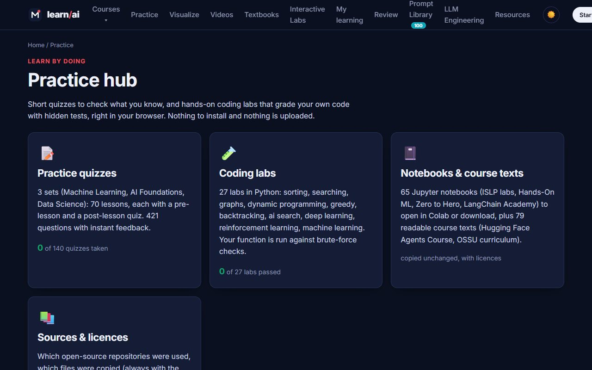
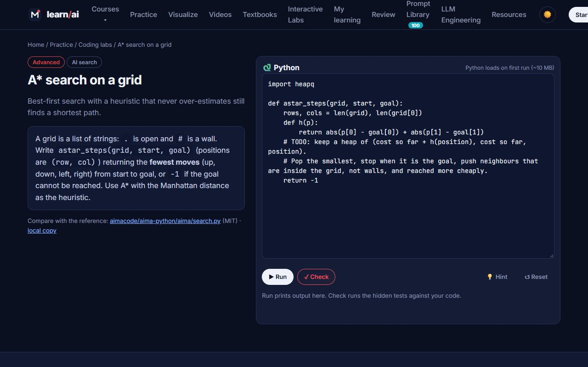
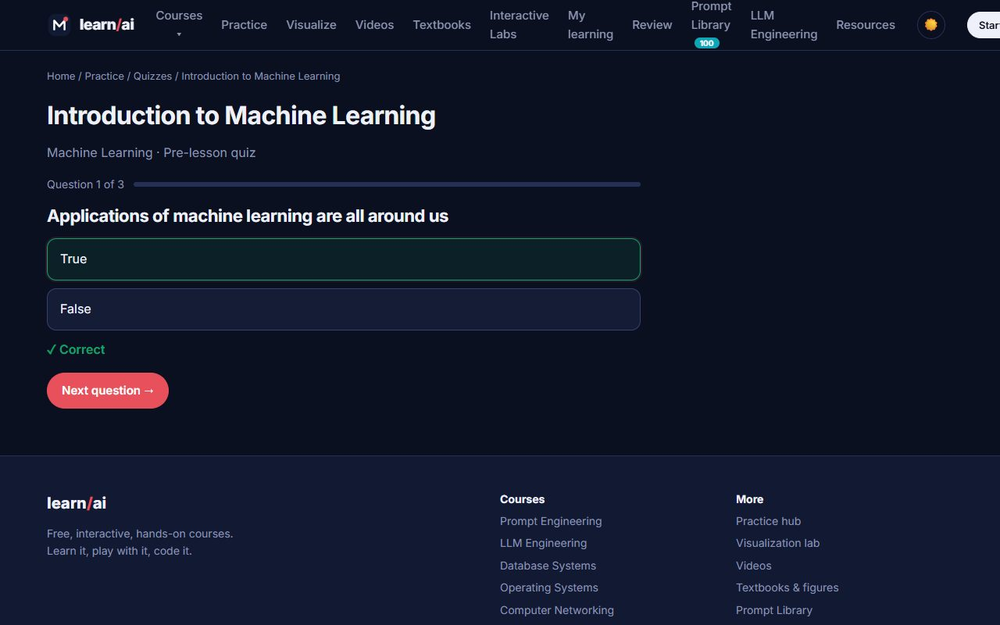
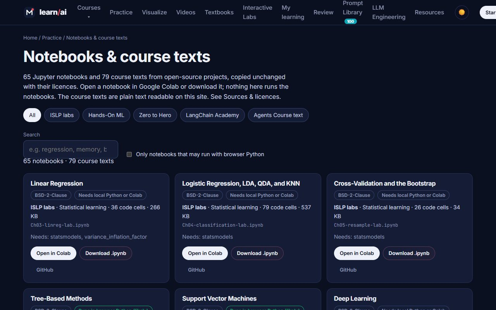
</div>

## 📈 Visualization lab

`#/visualize`: ideas you can move.

- **8 interactive charts** (Observable Plot): fitting a line, gradient descent on a stretched bowl, overfitting by polynomial degree, the central limit theorem, algorithm growth, softmax temperature, a 10-armed bandit and queueing delay. Each has sliders and a "what to notice" note.
- **9 diagrams with a live editor** (Mermaid): ML workflow, an agent loop, an LLM cascade, index choice, a transformer block and more. Edit the text and it redraws.
- **TensorFlow Playground**, bundled with the site and running in an iframe, so it does not depend on playground.tensorflow.org.

<div align="center">
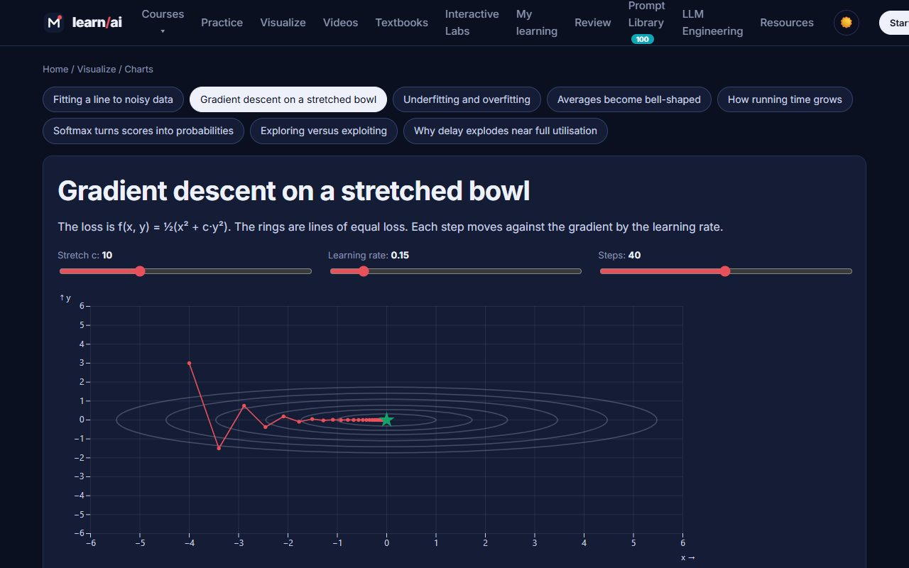
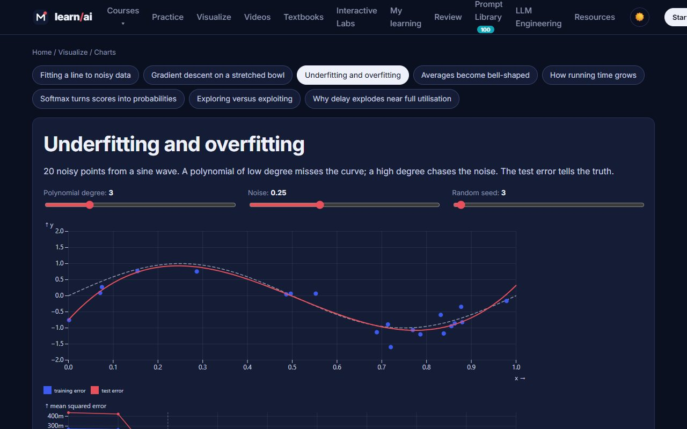
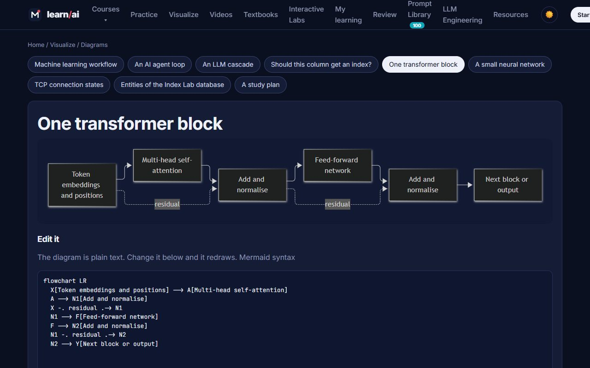
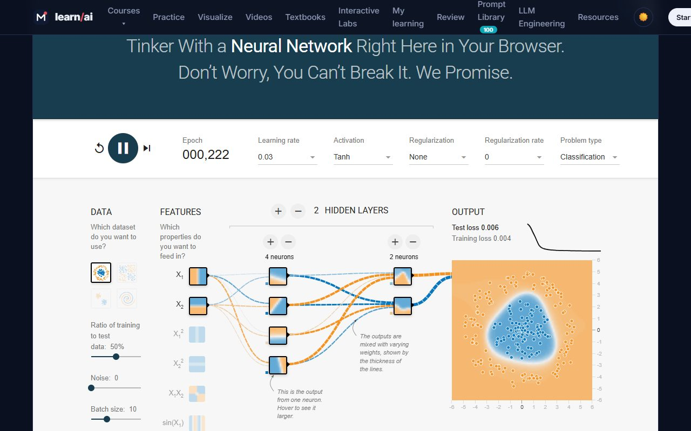
</div>

## 🎬 Videos

`#/videos`: **52 hand-picked videos by [3Blue1Brown](https://www.youtube.com/@3blue1brown)** on the mathematics behind machine learning: the neural-network and transformer series, essence of linear algebra and of calculus, differential equations, information theory, Bayes, convolution and the Fourier transform.

- **Embedded, never copied.** The player is YouTube's own. No video file is stored in this repository.
- **Click to play.** Until you press play, nothing contacts YouTube or Google, not even for a thumbnail. Then the video loads from the privacy-enhanced domain `youtube-nocookie.com`.
- **Verified.** `tools/build_videos.py` reads the titles and ids from YouTube's own feeds and checks that every video is by 3Blue1Brown and allows embedding.
- **Right inside the lessons.** 27 lessons in six courses (Deep Learning, Machine Learning, LLM Engineering, AI Foundations, Statistical Learning, Algorithm Design) carry the video that explains them: a 🎬 badge in the **course outline**, and the video itself inside the **lesson**, beside the lab. Only real matches are linked, for example the backpropagation videos on the multilayer-perceptron lesson and the Fourier transform on the FFT lesson. Each of those courses also has a "start here" strip, and seven textbook chapters show a "Watch" strip too.

<div align="center">
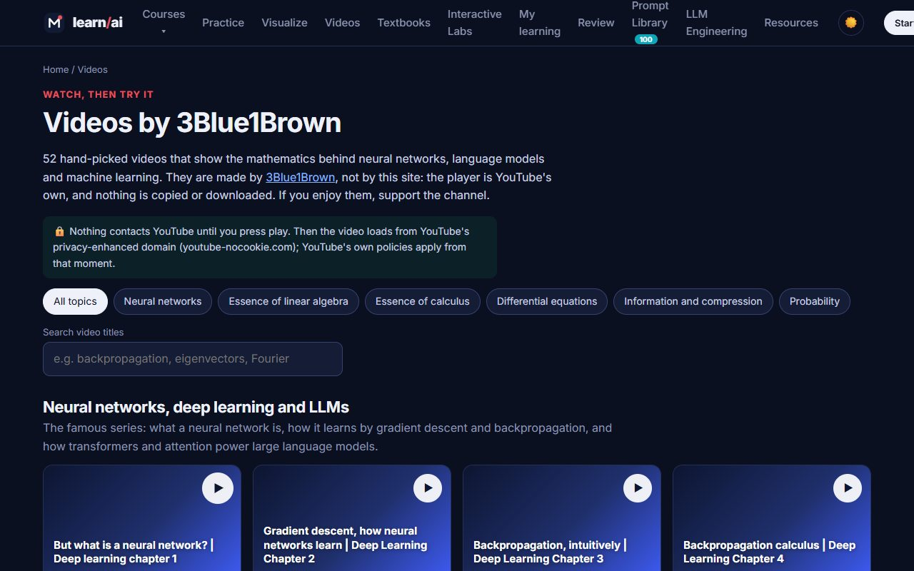
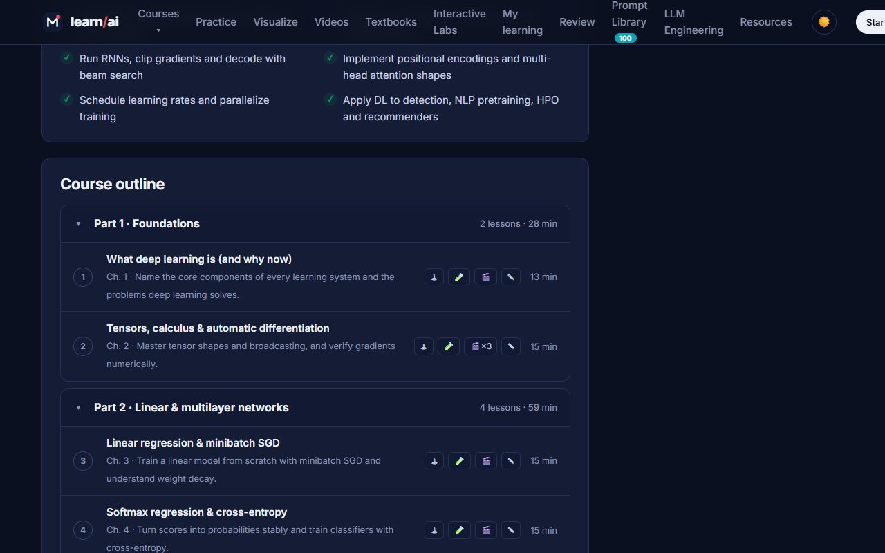
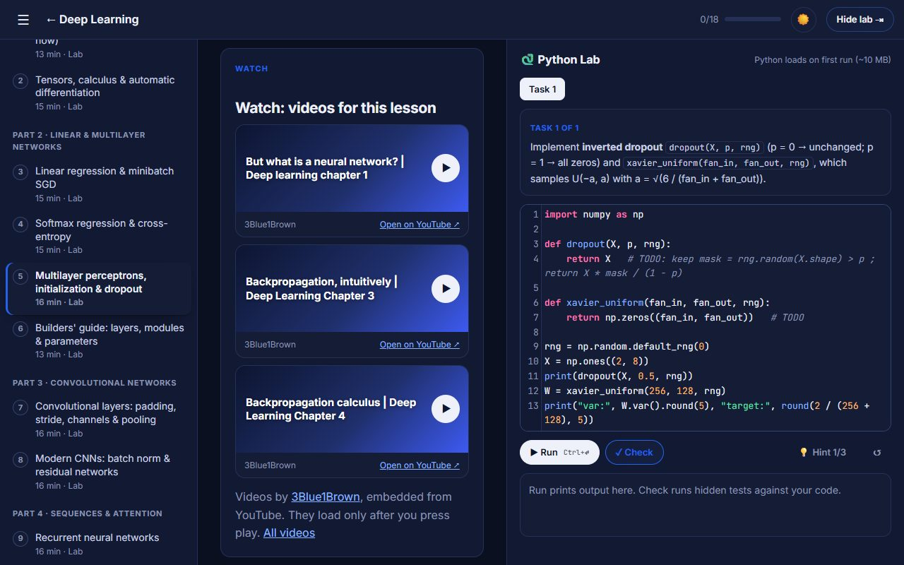
</div>

## 📚 Textbook companion

`#/books`: 70 guided chapters across seven textbooks (databases, reinforcement learning, deep learning, operating systems, networking, statistical learning and algorithm design). Every chapter has learning outcomes, original concept explanations, a worked example, a practice task with an answer, an interactive original figure and, new, a **Visual summary** with an editable diagram (14 chapters add an interactive chart; the neural-network chapters add the playground).

The site never includes a book's text or figures. The chapter pages link to page numbers so you can read the original in **your own** PDF, which stays on your device.

<div align="center">
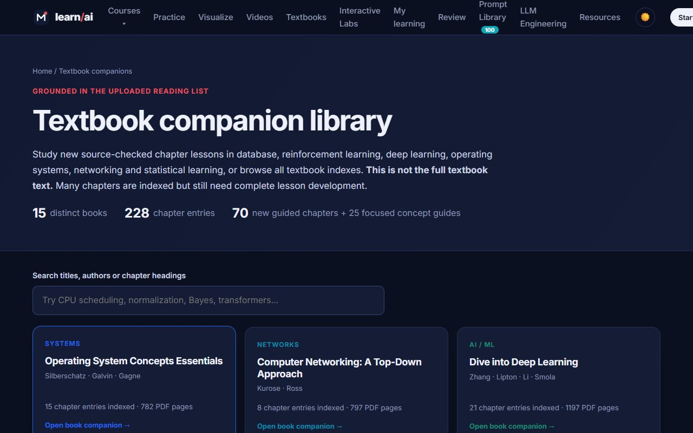
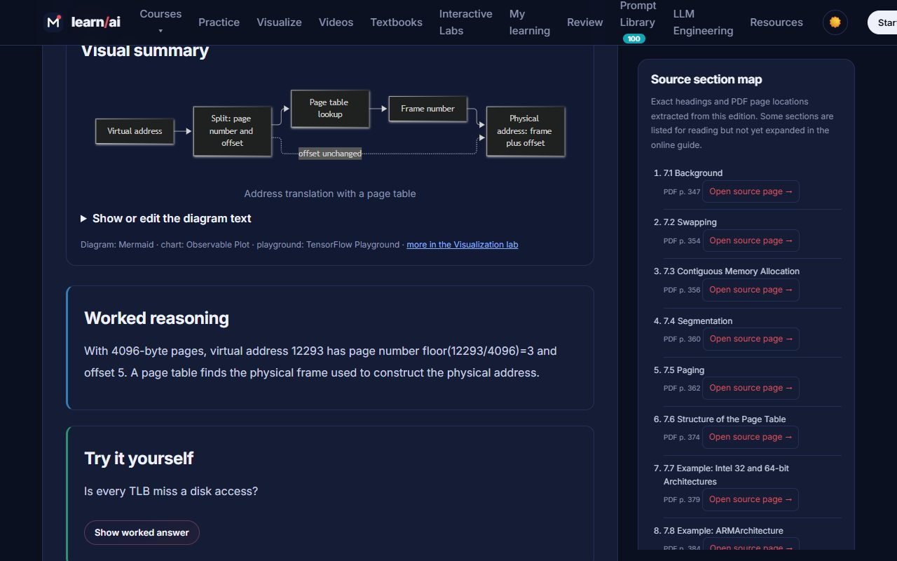
</div>

## 📱 Works on your phone

<div align="center">
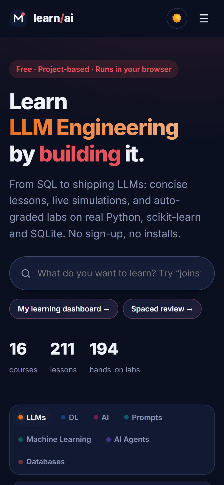
</div>

The main pages (home, courses, the Practice hub, the Visualization lab and the textbook chapters) are tested at phone width for horizontal overflow, and the diagrams scroll sideways instead of shrinking until they cannot be read.

## 🌐 Put it online (GitHub Pages)

The repository already includes a workflow (`.github/workflows/pages.yml`) that publishes the site.

1. Create a repository on GitHub and push this folder to it:
   ```bash
   git init
   git add .
   git commit -m "learn/ai"
   git branch -M main
   git remote add origin https://github.com/YOUR-USERNAME/YOUR-REPO.git
   git push -u origin main
   ```
2. On GitHub open **Settings, then Pages**, and under **Build and deployment** choose **Source: GitHub Actions**.
3. Open the **Actions** tab. When the *Deploy to GitHub Pages* run is green, your site is at `https://YOUR-USERNAME.github.io/YOUR-REPO/`.
4. Optional: upload `docs/images/social-preview.jpg` under **Settings, then Social preview** so links to your repository show a nice picture.

The repository is about 40 MB, mostly bundled libraries and notebooks, and well under GitHub's limits. `.nojekyll` makes sure GitHub Pages serves every folder as is.

## 🗂️ How it is organised

```text
index.html           The page shell (a single-page app with hash routing)
assets/              JavaScript, CSS and generated data; there is no build step
  app.js               router, course player, SQL and Python labs
  *-course.js          course content (one file per course)
  practice-*.js        the Practice hub and its generated data
  visualize.js         charts, diagrams and the playground; chapter-viz-data.js has the 70 chapter diagrams
downloads/           notebooks, slides, a starter pack, algorithm and R labs
third_party/         bundled open-source files, each with its licence; MANIFEST.json has their SHA-256
tools/               generators (practice data, screenshots, textbook audits)
tests/               Node and Playwright test suites
video/               an experiment: storyboards and a preview render for lesson videos
docs/                release history, phase notes, source audit, images
```

Where do I change things?

| I want to… | Edit |
|---|---|
| Add or fix a lesson | the course's `assets/*-course.js` file |
| Add a coding lab to the Practice hub | `tools/practice_labs_def.py` or `practice_labs_def2.py`, then `python tools/build_practice_hub.py` |
| Change a chapter diagram | `assets/chapter-viz-data.js` |
| Refresh the README screenshots | `python tools/make_screenshots.py` (site served on port 8000) |

## ✅ Tests

The site is checked by Node tests (data, logic, licences) and Playwright browser tests (real Chromium, Edge or Chrome).

```bash
# Node suites
for f in tests/*.test.cjs; do node "$f"; done

# Browser suites (pip install playwright; serve the site first: python -m http.server 8000)
export PYTHONUTF8=1
python tests/course-regression.py     # all courses and lessons render, zero JS errors
python tests/practice-labs.py         # 27 labs: solution passes, starter and 55 wrong variants fail
python tests/practice-experience.py   # quizzes, labs graded in Pyodide, notebooks, mobile
python tests/visualize.py             # charts, diagrams, playground and all 70 chapter diagrams
```

There are 19 Node suites and 25 Python suites in `tests/` (one of them, `local-reader-smoke.py`, needs PyMuPDF and your own PDF). On Windows set `PYTHONUTF8=1`. Pyodide and fonts come from a CDN, so a dropped connection can fail a lab test; run it again.

## 🔒 Privacy

- No account, no cookies set by the site, no analytics. Progress lives in your browser's `localStorage`.
- The TensorFlow Playground normally reports to Google Analytics; the bundled copy has that removed and a test proves no request is made.
- The site loads fonts from Google Fonts and Pyodide (about 10 MB, the first time you run Python) from a CDN.
- Videos load from YouTube only after you press play, using the privacy-enhanced domain; from then on YouTube's own policies apply.

## 🙏 Credits and licences

- **Created by [Rajesh Kumar](https://github.com/raja21068).** **Lesson text and slides:** [CC BY 4.0](https://creativecommons.org/licenses/by/4.0/); please credit "Rajesh Kumar, learn/ai". **Original code and notebooks:** MIT. See [LICENSE.md](LICENSE.md).
- **Quiz questions** are copied unchanged from three Microsoft repositories, all MIT: [ML-For-Beginners](https://github.com/microsoft/ML-For-Beginners), [AI-For-Beginners](https://github.com/microsoft/AI-For-Beginners) and [Data-Science-For-Beginners](https://github.com/microsoft/Data-Science-For-Beginners).
- **Reference code and notebooks:** [TheAlgorithms/Python](https://github.com/TheAlgorithms/Python), [aima-python](https://github.com/aimacode/aima-python), [Sutton and Barto implementations](https://github.com/ShangtongZhang/reinforcement-learning-an-introduction), [micrograd](https://github.com/karpathy/micrograd), [ISLP labs](https://github.com/intro-stat-learning/ISLP_labs), [Hands-On ML](https://github.com/ageron/handson-ml3), [Zero to Hero](https://github.com/karpathy/nn-zero-to-hero), [LangChain Academy](https://github.com/langchain-ai/langchain-academy), the [Hugging Face Agents Course](https://github.com/huggingface/agents-course) and [OSSU](https://github.com/ossu/computer-science).
- **Videos:** by [3Blue1Brown](https://www.youtube.com/@3blue1brown), embedded from YouTube and owned by their creator.
- **Libraries:** [Mermaid](https://github.com/mermaid-js/mermaid), [Observable Plot](https://github.com/observablehq/plot), [d3](https://github.com/d3/d3), [TensorFlow Playground](https://github.com/tensorflow/playground), [Pyodide](https://github.com/pyodide/pyodide) and [sql.js](https://github.com/sql-js/sql.js).
- Every copied file is unchanged (apart from the one documented change to the Playground), has its licence next to it, and is listed with its SHA-256 in [`third_party/MANIFEST.json`](third_party/MANIFEST.json). Full details: [THIRD_PARTY_NOTICES.md](THIRD_PARTY_NOTICES.md) and [docs/SOURCES_AUDIT.md](docs/SOURCES_AUDIT.md).
- Repositories with no licence or an unclear one (for example OSTEP and Dive into Deep Learning) are only linked, never copied.
- This project is not affiliated with Microsoft, Google, Anthropic or any project named above.

## 🧭 Honest status

This is a working, tested site, **not a finished one**.

- Practice quizzes exist for Machine Learning, AI Foundations and Data Science only. The other courses do not have them yet.
- The coding labs have no database, operating-systems or LLM tasks yet.
- Textbook coverage is partial: 83 of 98 Algorithm Design sections have no lab and chapters 8 to 13 have no guided study. See [TEXTBOOK_REBUILD_STATUS_v7.md](TEXTBOOK_REBUILD_STATUS_v7.md).
- The content has been tested by machines, not reviewed by subject experts. Please report mistakes.
- Accessibility (screen readers, contrast) and page speed have not been audited.
- Progress is stored per browser, with no sync between devices.

The release log is in [docs/RELEASE_HISTORY.md](docs/RELEASE_HISTORY.md) and the per-phase notes are in [docs/notes](docs/notes).

## 🤝 Contributing

Found a mistake in a lesson, a quiz or a diagram? Open an issue. Pull requests are welcome, especially:

- practice questions for the courses that have none (written for this project, with the same guessability checks as the course quizzes in `tests/quiz-guessability.test.cjs`),
- labs for databases, operating systems and LLMs,
- accessibility fixes.

Run the Node and browser tests before you open a pull request.

<div align="center">

**If this helps you learn, a ⭐ on the repository helps others find it.**

</div>
